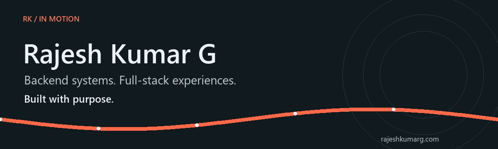

### Python Backend Developer · Full-Stack Developer

Coimbatore, India · Building useful software for real people

[Portfolio](https://www.rajeshkumarg.com) · [Project case studies](https://www.rajeshkumarg.com/work) · [Writing](https://www.rajeshkumarg.com/blog) · [LinkedIn](https://www.linkedin.com/in/rajesh-kumarg/) · [Email](mailto:rajeshkumarg.dev@gmail.com)

## The person behind the systems

I’m Rajesh Kumar G. I build APIs, full-stack applications, and the workflows that connect them. My work spans live education and business platforms, SaaS backends, and legacy telecom modernization.

I learn by building, deploying, investigating failures, and improving the result. Alongside independent projects and professional experience, I’m pursuing an M.E. in Computer Science and Engineering with a focus on AI and machine learning.

## What I build

- **Backend services:** Python, FastAPI, Django, REST APIs, permissions, and background processing.
- **Full-stack products:** Next.js and React interfaces connected to practical operational workflows.
- **Data foundations:** PostgreSQL, MySQL, SQLAlchemy, Prisma, and Redis.
- **Production delivery:** Docker, Linux, VPS deployments, Nginx, and CI/CD.
- **Legacy modernization:** Ported a C-based telecom IVR application to Python with Asterisk programming.

## Selected work

These applications are live and in use. Project names below are public aliases; the case studies focus on the engineering.

| Project | What it does | In practice |
| :--- | :--- | :--- |
| [Nexus](https://www.rajeshkumarg.com/work/nexus) | Student records, academic verification, and placement workflows | Used by **2,000+ students** |
| [Tempo](https://www.rajeshkumarg.com/work/tempo) | Staff scheduling, availability, and workload planning | Used by **approximately 50 staff** |
| [Stride](https://www.rajeshkumarg.com/work/stride) | Competency progression, assessments, and operational workflows | Live and used by teams |
| [Folio](https://www.rajeshkumarg.com/work/folio) | Certificate issuance, template management, and signed QR verification | Live and used by teams |
| [Ledger](https://www.rajeshkumarg.com/work/ledger) | GST-aware invoicing, spreadsheet input, and generated PDFs | Live and used by teams |

[Explore the architecture and engineering decisions →](https://www.rajeshkumarg.com/work)

## My toolkit

| Area | Technologies |
| :--- | :--- |
| Backend | Python · FastAPI · Django · Flask · SQLAlchemy · Asyncio · Asterisk |
| Frontend | TypeScript · JavaScript · Next.js · React · Tailwind CSS |
| Data | PostgreSQL · MySQL · Redis · Prisma |
| Background work | Celery · BullMQ |
| Infrastructure | Docker · Linux · Nginx · AWS EC2, S3, CodeDeploy · Git · CI/CD |
| Quality & design | pytest · Figma |

## Experience & research

- Developed SaaS backend features, worked on a customer-management portal backend repository, and modernized an IVR application at **Mallow Technologies**.
- Delivered technical training and developed operational software at **Rathinam Technical Campus** and **Rathinam Global University**.
- Co-inventor of **UACEIP**, a published Indian patent application exploring a quantum-neuro-symbolic digital twin architecture. **Application 202641087385**, published **24 July 2026**. Status: **published application**.

<strong>A little more about how I work</strong>

I care about clear permissions, dependable data models, and separating background work from the request path. I use AI coding tools as part of my workflow, while reviewing the decisions, testing the behavior, and taking responsibility for what ships.

My GitHub shows one part of the journey. Some production projects are private, so I document their public engineering stories in my portfolio.

## Let’s build something useful

Open to Python backend and full-stack roles, freelance projects, and collaboration on APIs, automation, SaaS, and legacy migrations.

**Have a project in mind?** [Start a conversation](https://www.rajeshkumarg.com/contact) or email **rajeshkumarg.dev@gmail.com**.

**Still learning. Still building. Now in motion.**

